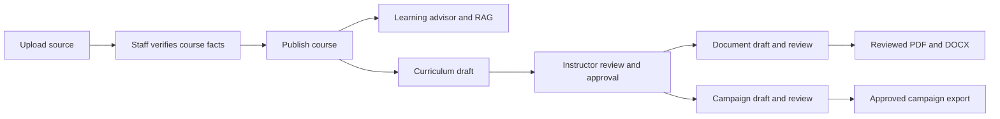

# Andalusia Academy — REX AI

REX AI connects five academy workflows: course advice, educational opportunity research, curriculum design, training documents and marketing campaigns. FastAPI provides the services; Streamlit provides one learner and staff workspace.

## Run locally

Use the existing repository root. Python 3.14 is used by CI.
Use a fresh virtual environment for the default installation; an existing global environment may retain optional packages and older dependencies.

```powershell
python -m venv .venv
.\.venv\Scripts\Activate.ps1
python -m pip install --upgrade pip
python -m pip install -r requirements-dev.txt
# Copy .env.example to .env only if .env does not already exist.
python -m uvicorn backend.app.main:app --host 127.0.0.1 --port 8000
```

In another terminal:

```powershell
python -m streamlit run frontend/app.py
```

Open http://127.0.0.1:8501. API documentation is at http://127.0.0.1:8000/docs. Restart the backend after changing credentials or provider configuration. Staff use their name and the local administrator key to sign in once.

## Free-tier configuration

Create a key at https://console.groq.com/keys. Keep it in the ignored local `.env`; never share or commit it. Set:

```dotenv
REX_AI_PROVIDER=groq
GROQ_API_KEY=your_local_key
GROQ_TEXT_MODEL=openai/gpt-oss-20b
REX_RETRIEVAL_BACKEND=sqlite
REX_ENABLE_AI_WEB_SEARCH=0
REX_CATALOG_ADMIN_KEY=your_strong_local_staff_key
```

Groq free-tier requests have account quotas and can become temporarily unavailable. SQLite FTS5 provides local, persistent keyword retrieval over approved course facts; it needs no embedding API, model download or hosted vector service. Common Arabic/English query terms are supported. It is lexical retrieval, rather than semantic vector search. Gemini text generation and Gemini/Chroma retrieval remain available through configuration.

Provider browser search is separately priced and remains disabled by default. RFP imports, configured public feeds and country filtering work independently of paid search. OpenCode's free client does not make every hosted model or external-client API request free. See [provider setup](docs/PROVIDER_SETUP.md).

## Five connected agents

| Agent | Working behavior |
|---|---|
| Learning advisor | Arabic/English answers using published course facts; guided learner qualification; deterministic budget, delivery and level checks; cited recommendations; consented lead capture. |
| RFP research | Process portal exports or configured sources; enforce Egypt/Saudi Arabia rules, deadlines, relevance and deduplication; AI summaries; searchable status dashboard and alerts. Discovery results require verification. |
| Curriculum | Research published source records; generate modules, outcomes, hours, practice, assessments and a capstone; compare against staff-verified framework criteria; review, revise and export a Unicode PDF. |
| Documents | Ten reviewed template categories; English/Arabic DOCX and PDF; direct content edits and AI-assisted revisions; immutable versions, source citations, file integrity checks and human approval. |
| Marketing | Read published course facts and an approved curriculum; create seven channel types with multiple variations; edit, review and export approved campaigns. Distribution remains manual. |

The learner chat handles greetings, explains its capabilities and provides general learning/career guidance even before course records are published. It sends up to twelve recent messages for conversational follow-ups, with only user/assistant roles accepted. General guidance is labelled separately; specific academy course claims still require current approved evidence and citations. Staff-only actions remain outside the learner assistant.

Saved sources and generated documents have separate views. Uploads retain their original format and can be downloaded unchanged through an authenticated integrity-checked endpoint. Source review supports filename search, format filters and a read/check/publish sequence. Document history displays immutable versions, source filenames and dated review events. The other workspaces use searchable record cards, plain-language statuses and visible choices; technical details are optional.

## Connected workflow

### Instructor workspace

The staff-only Instructor workspace provides persistent chat across the five agent workflows. It uses the existing staff sign-in and 44 explicitly registered internal API tools. Users can find sources and saved records, generate or revise curricula, documents and campaigns, manage catalog review/publication, research opportunities and request authenticated exports. Course sources and opportunity exports can also be attached on the page.

The planner proposes actions; every write requires confirmation. Review and publication decisions require a separate action, an inspection acknowledgement and a check that the record has not changed since its preview. Existing source verification, template approval and downstream review gates still apply. An approved curriculum is required before creating a related campaign. The individual agent pages remain available for detailed editing and review.

Conversations and action outcomes persist in runtime-specific SQLite storage. Repeated execution requests return saved results rather than generating duplicate artifacts. Failed actions stop the remaining steps and preserve completed work. If the server stops during an action, inspect the agent's records before retrying from a new conversation; cross-service work is not a single database transaction. The chat cannot execute arbitrary URLs, code or SQL, and RFP notifications are forced off. Login uses the application's existing shared staff key and declared reviewer name, rather than individual user accounts.



Curricula are proposed teaching plans, not new published catalog entries. They cannot publish courses automatically. Curriculum-based documents and campaigns require an approved curriculum linked to their selected course. Source withdrawals or revisions invalidate downstream approval/export eligibility. Alignment reports never confer official accreditation.

## Isolated sample mode

An optional sample mode separates fictional records from academy storage. Supply an external sample pack through `REX_DEMO_EXAMPLES_DIR` (an absolute directory containing `course_manifest.json`, its referenced course files and `tenders.json`), then run:

```powershell
python scripts/run_demo.py
```

The frontend uses port 8510 and the backend uses port 8010. Staff authentication and publication review are required in both modes. Sample packs and personal preparation materials are not distributed with the application. Automated tests generate their own temporary fixtures.

## Checks

```powershell
python -m compileall -q backend frontend
python -m pytest tests/ backend/app/agents/rfp/tests/ -q
```

Offline tests isolate storage and mock external AI calls. For an intentional real Groq check using temporary test records:

```powershell
$env:REX_RUN_LIVE_TESTS='1'
python -m pytest tests/test_live_academy_workflow.py -q
Remove-Item Env:REX_RUN_LIVE_TESTS
```

## MCP

Run `python -m backend.app.mcp_server` for the local stdio MCP server. It exposes ten tools covering published course discovery/retrieval, consented lead capture, document templates/drafts, approved curricula, curriculum drafts, campaign drafts and stored RFP opportunities. Staff tools require `REX_MCP_STAFF_KEY` matching the administrator key. MCP cannot approve records, publish courses, send messages or distribute campaigns.

## Operations and limits

- Persist `data/` securely and back it up. Keep `.env`, SQLite databases, sidecars and generated runtime files out of Git. Demo records remain explicitly fictional.
- Shared staff keys support controlled local use. Public deployment requires HTTPS, individual staff accounts, roles, rate limits and deployment-specific operational controls.
- Academy staff must verify source records and reference frameworks, review generated outputs and configure portal access.
- External email distribution is not triggered by the normal UI. Existing RFP notification integrations require deliberate operator configuration.
- Scanned PDFs require Tesseract with English/Arabic language data. Ordinary text PDF, Word and Markdown ingestion do not require OCR. On Ubuntu: `sudo apt-get install tesseract-ocr tesseract-ocr-eng tesseract-ocr-ara`.

Direct runtime and development dependencies are pinned to tested versions. Default installation uses SQLite retrieval and excludes Chroma. The preserved Gemini/Chroma path needs `python -m pip install -r requirements-vector.txt`; review the unresolved upstream advisories in [security notes](docs/SECURITY.md) before enabling it. Never expose a Chroma HTTP server. The local staff-key model is not suitable for unrestricted public deployment.

Technology: Python, FastAPI, Streamlit, SQLite/FTS5, Groq or Gemini, optional Chroma, PyMuPDF, python-docx and FastMCP.

## Academy visual identity

The interface uses the official logo and copper/charcoal palette from https://andalusia-academy.com/. Generated PDF and Word files use a portfolio-style cover, burgundy section banners, copper details, readable tables and a source appendix, using the academy portfolio document style. English and Arabic layouts are supported. Saved artifacts are immutable; create a new revision to apply a newer visual style and approve the current template version before generation.
