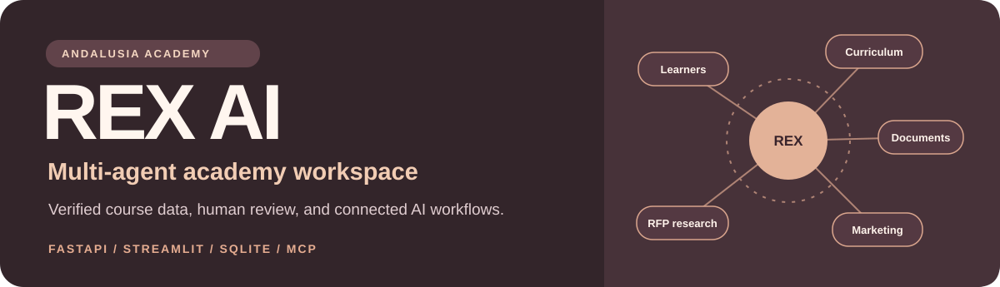
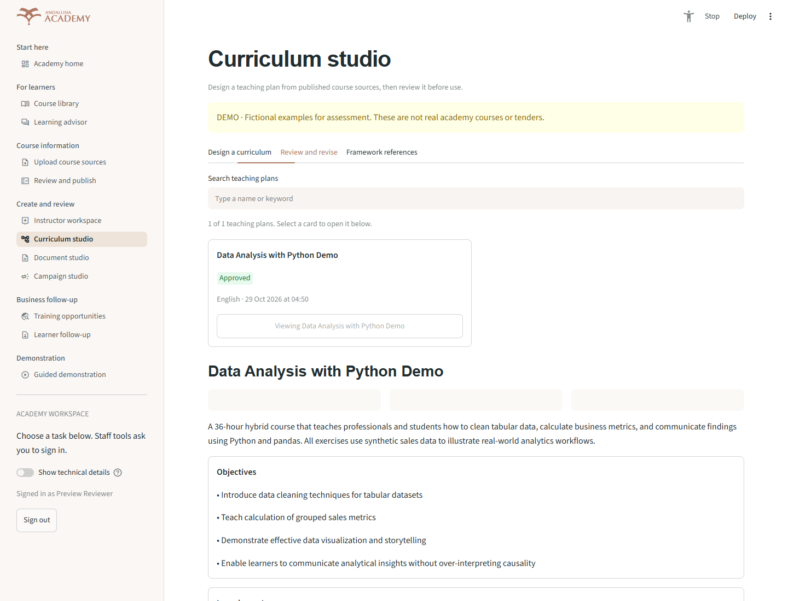
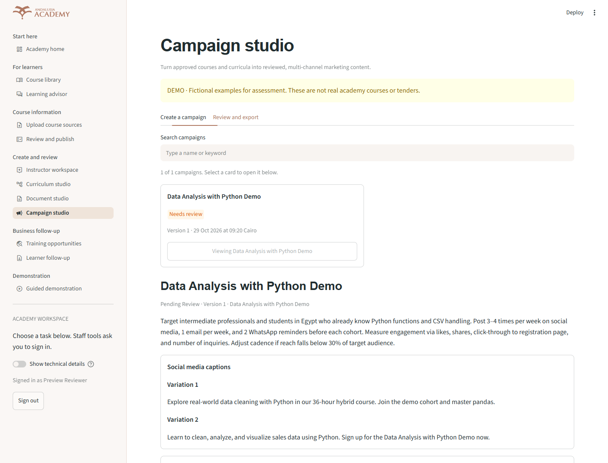
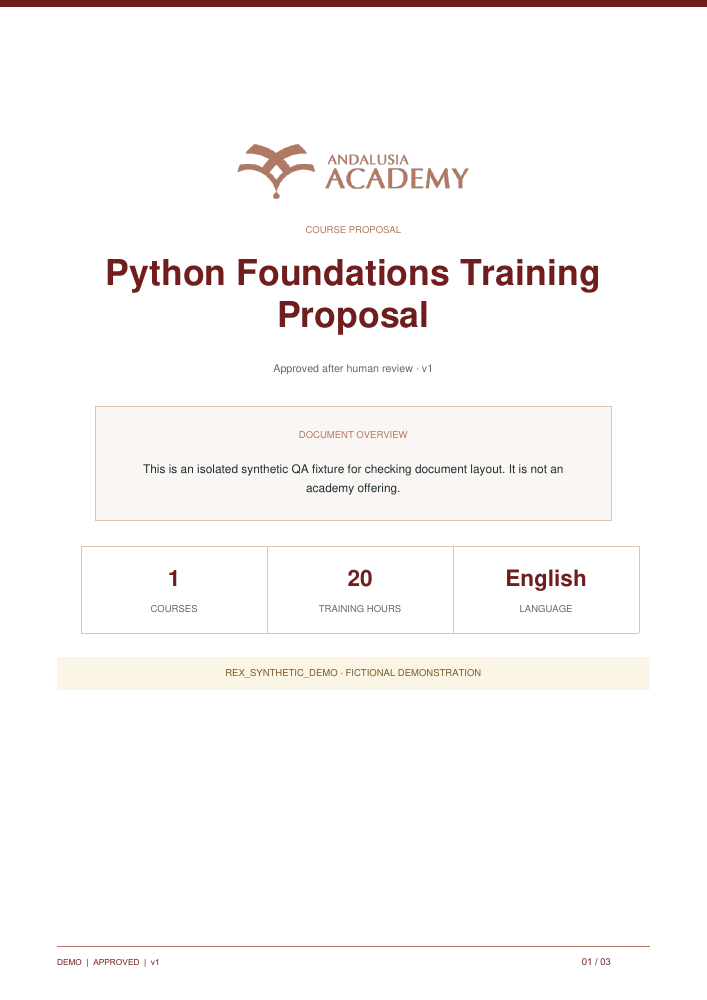
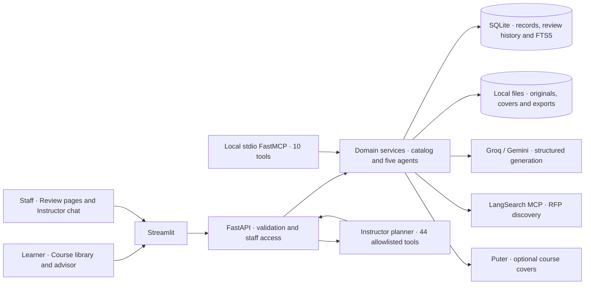
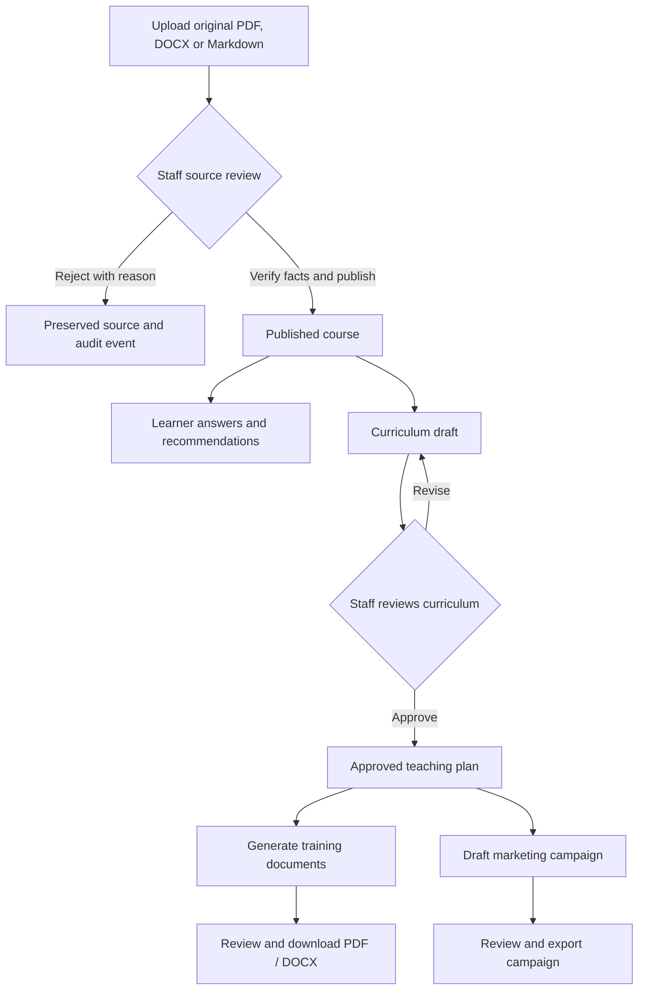

<p align="center">
  
</p>

<p align="center">
  <a href="https://github.com/Z4iM/REX_AI/actions/workflows/ci.yml"></a>
  
  
  
  
</p>

# REX AI

REX AI is a multi-agent training operations MVP developed for **Andalusia Academy**. It helps staff turn verified course information into teaching plans, training documents, and marketing campaigns. Learners get course guidance from the same published catalog, while staff can research training tenders in Egypt and Saudi Arabia.

**The main engineering decision:** a model can suggest facts, draft content, and propose actions. The application verifies record state and source provenance, and staff make the decisions that publish or approve work.

[Quick start](#quick-start) · [Product preview](#product-preview) · [Architecture](#architecture) · [Verification](#verification)

## Product preview

<table>
  <tr>
    <th>Curriculum Studio</th>
    <th>Campaign Studio</th>
  </tr>
  <tr>
    <td width="50%"></td>
    <td width="50%"></td>
  </tr>
</table>

*Screenshots are from the isolated demo workspace using fictional data. Labels and navigation can differ from the latest build.*

<details>
<summary>See a generated training proposal</summary>
<p align="center"></p>
</details>

| Workspace | What it delivers |
|---|---|
| **Learning Advisor** | Arabic and English guidance, a guided qualification flow, source-cited course answers, constraint-aware recommendations, and consented lead capture. |
| **RFP Research** | JSON, CSV and Excel imports; LangSearch MCP discovery and public tender directories; Egypt/Saudi Arabia filters, expiry checks, deduplication and dashboard alerts. Search leads require verification. |
| **Curriculum Studio** | Structured modules, hours, activities, assessments and capstones, with revision history and PDF export. Staff can compare plans against verified framework criteria. |
| **Document Studio** | Ten template categories, Arabic and English output, branded PDF and editable Word files, source references, and versioned review. |
| **Campaign Studio** | Campaign strategy and variations for social captions, Facebook/Instagram, LinkedIn, email, WhatsApp, headlines and calls to action. Approved export is available after review; distribution is manual. |
| **Instructor workspace** | Persistent staff conversations and a planner that proposes actions across the workflows. It uses allowlisted internal APIs, requires confirmation for writes, and keeps approval decisions separate. |

## Architecture



The default retrieval path is SQLite FTS5 over staff-verified course facts. Gemini embeddings and embedded Chroma are optional. The Instructor planner uses internal API calls; the local MCP server is a separate integration for external clients.



**Engineering highlights**

- **Traceable data:** original files retain their format and checksum. Rejected uploads cannot feed publication. Retrieval checks the current published record and source revision.
- **Reviewable changes:** versioned outputs and audit history preserve decisions. Withdrawn or superseded sources can block dependent approvals or exports.
- **Controlled orchestration:** request identifiers protect against duplicate execution. Decision previews are rechecked before execution. A new curriculum must be reviewed before dependent work can use it.
- **Bounded inputs:** upload and Office archive limits, isolated demo storage, and source validation reduce accidental exposure and unsafe processing.
- **Optional integrations:** provider errors surface without fabricating output. Course publication does not depend on Puter; cover generation runs once per revision after publication, and browsing reads the stored image.

## Quick start

Use **Python 3.14** and run the commands from the repository root. In PowerShell:

```powershell
python -m venv .venv
.\.venv\Scripts\python.exe -m pip install -r requirements-dev.txt
if (-not (Test-Path .env)) { Copy-Item .env.example .env }
```

Set the following in the ignored local `.env`. Replace the placeholders locally.

```dotenv
REX_APP_MODE=academy
REX_CATALOG_ADMIN_KEY=your_local_staff_secret
REX_AI_PROVIDER=groq
GROQ_API_KEY=your_local_provider_key
REX_RETRIEVAL_BACKEND=sqlite
```

Start FastAPI and Streamlit in separate terminals:

```powershell
# Terminal 1
.\.venv\Scripts\python.exe -m uvicorn backend.app.main:app --host 127.0.0.1 --port 8000
```

```powershell
# Terminal 2
.\.venv\Scripts\python.exe -m streamlit run frontend/app.py --server.port 8501
```

Open [REX AI](http://127.0.0.1:8501/) or the [interactive API reference](http://127.0.0.1:8000/docs). The Academy catalog starts empty. Staff can sign in, upload a verified course source, check its details, and publish it. AI drafting needs a configured text provider; file staging, structured field extraction, and SQLite publication do not.

| Optional integration | Setup |
|---|---|
| LangSearch | Set `LANGSEARCH_API_KEY` for RFP web discovery. File imports and public directory sources remain available separately. |
| Puter | Install Node.js 24+, run `npm --prefix scripts/puter ci --ignore-scripts`, then set `PUTER_AUTH_TOKEN`. New course publications can generate cover art. |
| Gemini and Chroma | See [provider setup](docs/PROVIDER_SETUP.md) and the [Chroma security notes](docs/SECURITY.md). Use the separate vector requirements only when needed. |
| OCR | Install Tesseract with English and Arabic language packs for scanned PDFs. Text PDFs, DOCX and Markdown do not require OCR. |
| Demo mode | Configure an external sample pack via `REX_DEMO_EXAMPLES_DIR`, then run `python scripts/run_demo.py`. The demo uses separate storage and ports 8010/8510. |

Restart FastAPI after configuration changes. See the [provider guide](docs/PROVIDER_SETUP.md) for details.

## Verification

```powershell
.\.venv\Scripts\python.exe -m compileall -q backend frontend
.\.venv\Scripts\python.exe -m pip check
.\.venv\Scripts\python.exe -m pip_audit --local
.\.venv\Scripts\python.exe -m pytest tests/ backend/app/agents/rfp/tests/ -q
```

The latest application release check on commit `2d01734` recorded **514 passed, 7 skipped**. Offline tests cover authorization, rejection and publication, retrieval and source withdrawal, orchestrator confirmation, RFP filtering, course covers, exports, and Streamlit interactions. Provider tests are opt-in; tests use isolated data and mocks where appropriate.

[GitHub Actions](.github/workflows/ci.yml) runs syntax checks, a dependency audit, and the offline suite on Ubuntu with Python 3.14. CI does not deploy the application or verify provider availability.

## Repository guide

| Path | Responsibility |
|---|---|
| [frontend/](frontend/) | Streamlit learner and staff workspace |
| [backend/app/catalog/](backend/app/catalog/) | Uploads, staff review, publication, covers, and approved retrieval |
| [backend/app/agents/](backend/app/agents/) | Curriculum and RFP agent services |
| [backend/app/instructor/](backend/app/instructor/) | Persistent chat, action planning, tool registry and confirmation |
| [backend/app/documents/](backend/app/documents/) · [marketing/](backend/app/marketing/) | Document rendering and campaign drafts, reviews, and exports |
| [tests/](tests/) · [docs/](docs/) | Automated checks, architecture, workflows, and API contracts |

Read the [current architecture](docs/ARCHITECTURE.md), [agent workflows](docs/AGENT_WORKFLOWS.md), [OpenAPI snapshot](docs/openapi.current.json), and [security and deployment notes](docs/SECURITY.md) for more detail. Team workstreams are documented in the [WBS](docs/WBS.md); individual contributions are traceable through Git history and pull requests.

This MVP is designed for controlled local use. Shared staff authentication is not individual identity or role-based access. A public deployment would need individual accounts, deployment security, monitoring and an operational data policy. Staff must verify real catalog data, procurement leads and accreditation criteria before using them in academy operations.
