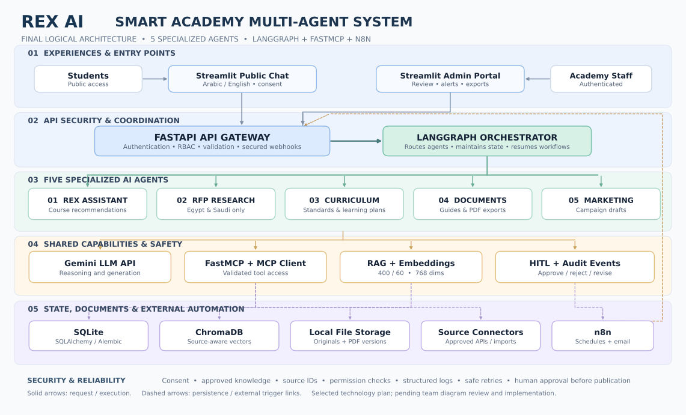
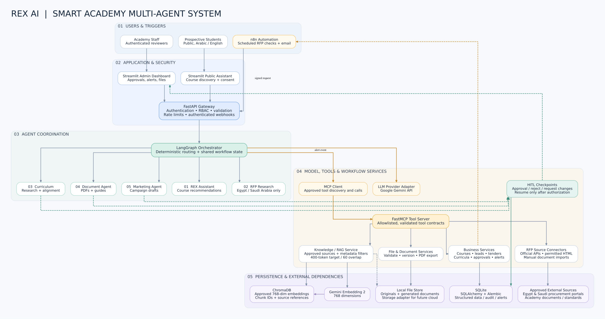
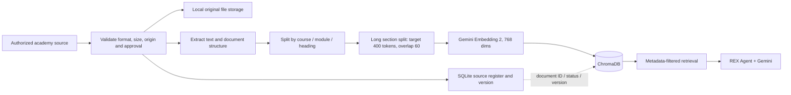
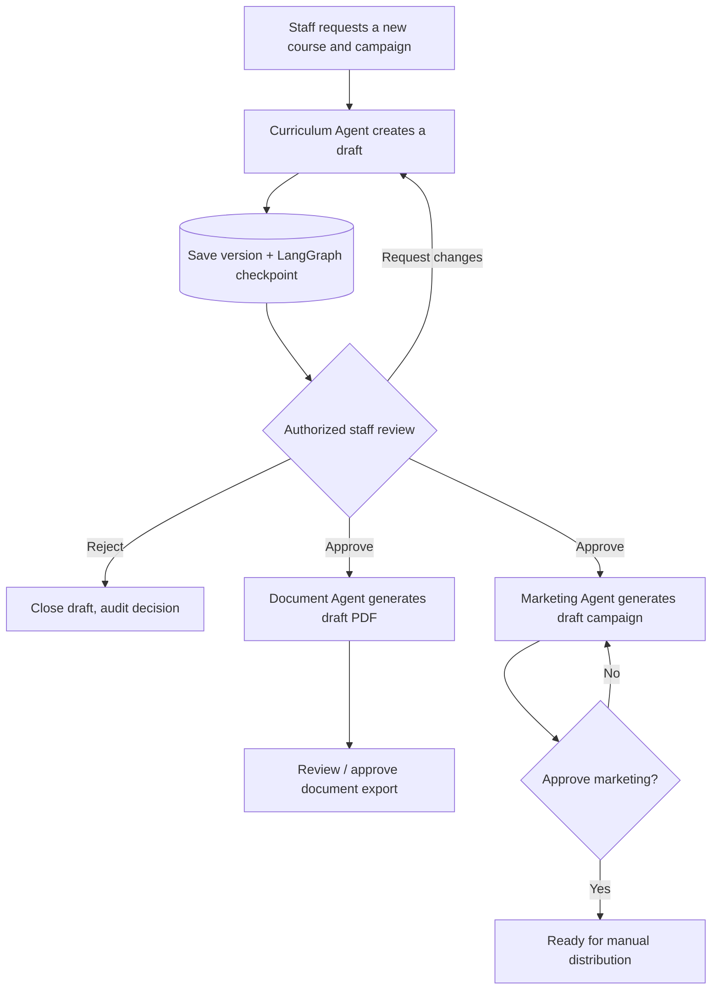

# REX AI — System Architecture

## Current implementation

The application runs five agent workflows through FastAPI and Streamlit. Groq is the default text provider; Gemini remains optional. SQLite stores reviewed course metadata, learner sessions and consented leads, documents, campaigns, curriculum records, RFP opportunities and instructor actions. Approved-only SQLite FTS5 retrieval is the default; Gemini embeddings with Chroma remain available.

The instructor planner uses 44 allowlisted internal API tools with persisted proposals, explicit confirmation, review snapshots and deterministic service validation. A separate stdio FastMCP server exposes ten controlled tools. The instructor does not use an MCP client or LangGraph. Source publication, template approval and downstream human review are enforced by the domain services.

Shared staff-key authentication is intended for controlled local operation. Individual accounts/RBAC, public-route rate limiting, managed deployment, Alembic migrations and scheduled n8n workflows are not implemented. Existing RFP SMTP/webhook integrations require deliberate configuration; normal UI actions do not distribute content.

The sections and diagrams below preserve the original Sprint 1 design proposal. Technologies and controls described there are targets unless confirmed in this current implementation section or the [README](../README.md).

## Historical Sprint 1 design proposal

**Project:** REX AI — Smart Academy Multi-Agent System  
**Organization:** Andalusia Academy  
**Team:** Faris Ahmed · AbdulRahman Adham · Ahmed AlAbiad  
**Status:** Architecture proposal for team review — **not an implemented system**  
**Sprint 1 milestone:** October 18, 2026  
**Final project deadline:** November 5, 2026

*Figure 1 — REX AI logical component overview (simplified).*

*Figure 2 — Detailed logical dependencies, source connections and approval checkpoints.*

> The diagram above is an implementation plan. Neither deployment nor functional integrations are implied. The team will review and implement the components incrementally in Sprints 1–3.

## 1. Architectural purpose and scope

The approved graduation brief calls for a functional MVP consisting of **five specialized agents**, shared knowledge and data, coordinated workflows, traceable source information, and at least one multi-agent workflow. REX AI must deliver working tasks rather than only a chatbot interface.

**Scope priorities:** reliable demonstrations, authorized academy data, correct RFP geography, visible human review, source traceability, real tests and authentic GitHub team contributions. Full production scaling is outside the graduation MVP.

## 2. Agreed technology decisions

| Concern | Selected technology / approach | Reason or constraint |
| --- | --- | --- |
| Frontend | **Streamlit** | One Python-based interface with public and admin experiences |
| Backend | **FastAPI** | API layer, input validation and authentication boundaries |
| LLM | **Google Gemini API** behind a provider adapter | Centralized generation service; specific generation model to be configured and verified |
| Orchestration | **LangGraph** | Explicit multi-agent routes, shared state, approval interruptions |
| Tool protocol | **FastMCP server + MCP client** | Allowlisted tool interfaces; do not expose arbitrary SQL or filesystem access |
| Embeddings | **Gemini Embedding 2 (`gemini-embedding-2`)**, 768 dimensions | External embedding API, compatible vectors within a single collection |
| Vector storage | **ChromaDB** | Semantic similarity and source-aware retrieval |
| Chunking | **Structure-aware hybrid**, ~400-token target / ~60-token overlap for long sections | Preserve course, module and standards boundaries; tune by retrieval tests |
| Structured database | **SQLite + SQLAlchemy + Alembic** | Relational records and version-controlled schema migrations for MVP |
| Document files | **Local filesystem** behind replaceable storage interface | File IDs and paths, original/generated versioning; excluded from Git |
| Automation | **n8n + LangGraph** | n8n starts scheduled/external workflows; LangGraph executes agent logic |
| Notifications | **Streamlit dashboard + n8n email** | Save notifications in database; external email only after integration is configured |
| Human approvals | **LangGraph interrupts + persisted checkpoints** | Admin reviews before approval-controlled downstream steps |
| External research | **Hybrid**: approved APIs, permitted page extraction, manual imports | Connectors verified per source, no bypassing authentication/access controls |
| Security | **Public course chatbot + authenticated staff dashboard**, RBAC, secrets management | Admin workflows must not be reachable as public endpoints |
| Observability | **Structured Python logs + SQLite audit records** | Request IDs, outcomes, provenance, error and approval events |

**Pending confirmation during implementation:** exact Gemini generation model and quotas, academy-approved catalog/reference templates, availability and permitted usage of specific tender source integrations, email sender credentials, secure deployment host, and authentication design details.

## 3. Logical components

### 3.1 Interfaces and backend

- **Public Student Interface (Streamlit):** Arabic/English course discovery, follow-up qualification questions, course details from approved sources, optional consensual lead capture.
- **Private Staff Interface (Streamlit):** agent workflows, content review, RFP dashboard, alerts, downloadable approved outputs, audit-friendly history.
- **FastAPI:** separates public and admin routes; performs validation, authentication, role checks, payload limits, API rate limits, and protected n8n webhooks.

### 3.2 Coordination and AI

- **LangGraph:** selects workflow, coordinates specialized agent nodes, persists state, pauses for staff approval when necessary, and resumes only after an authorized decision.
- **Gemini provider adapter:** centralizes generation-model configuration, token/cost/latency logging, retries for temporary errors, and structured response validation.
- **MCP client → FastMCP server:** agents invoke a fixed allowlist of validated tools; tools call domain services. This boundary is for *tool access*, not a replacement for every ordinary internal Python function call.

### 3.3 The five agents

| Agent | Main input | Required output | Example shared tools / controls |
| --- | --- | --- | --- |
| **1. Course Assistant** | Student goals, skill level, interests | Relevant, explained course recommendations | `search_courses`, `get_course_details`, `capture_lead_with_consent` |
| **2. RFP Research** | Allowed countries, categories, deadline range | Source-linked, deduplicated, verified tender records | `search_tenders`, `get_tender_details`, country/deadline validators |
| **3. Curriculum & Accreditation** | Topic, audience, objectives, standards | Curriculum + evidence-linked gap analysis | `retrieve_standards`, `save_curriculum_draft`, admin approval |
| **4. Document Generation** | Approved data, requested template | Downloadable, well-formatted PDFs (at least 3 document types for MVP) | `get_document_template`, `render_pdf`, source/version controls |
| **5. Marketing** | Approved course information, channel and audience | Multi-channel campaign drafts | `get_approved_course`, `save_campaign_draft`, human approval |

Tool names above are **proposed interface contracts**, not endpoints already implemented.

## 4. Data flow — public course recommendation

1. Student types a question in public Streamlit chat; FastAPI validates the payload and applies public-route limits.
2. LangGraph invokes Course Assistant and gathers missing learner context (background, experience, goal, etc.).
3. Retrieval services fetch **approved** knowledge chunks from ChromaDB and exact fee/schedule/offer values from SQLite.
4. Gemini generates an answer grounded in retrieved source records; response validation checks citation references and removes unsupported claims where possible.
5. The assistant answers and offers a consent-based lead form. No lead data is saved without consent.

## 5. Data flow — knowledge ingestion and retrieval

**Ingestion invariants:** isolate independent courses; preserve FAQ question-answer pairs, tables/headers, standard sections and page/source IDs; do not mix embedding-model vector spaces; do not index unapproved sources into the production-approved collection. Store prices/schedules as structured, updateable fields in SQLite.

**Suggested chunk metadata:** `document_id`, `source_id`, `course_id`, `section`, `language`, `approval_status`, `source_name`, `page_number`, `updated_at`, `version`, `content_hash`.

## 6. Data flow — tenders and automation

1. n8n Schedule Trigger or a manual admin action calls a **protected FastAPI endpoint**.
2. LangGraph starts the RFP agent, invoking source-specific FastMCP tools.
3. Source adapters use permitted APIs, publicly accessible allowed pages, or imported tender files; each hit retains original source URL, issuer, publication date and deadline.
4. **Python validators** reject unrelated, expired, duplicate and out-of-scope opportunities. Only explicitly verified **Egypt** or **Saudi Arabia** opportunities pass the geography rule; ambiguous items require review.
5. Valid records are upserted into SQLite. Egyptian matches create high-priority dashboard alerts; Saudi matches enter the monitored pipeline.
6. n8n may send an email alert based on a recorded event, after credentials and staff-recipient rules are configured. Retries and deduplication must not send the same alert repeatedly.

**RFP source integrations are research targets until access methods are tested.** An imported sample can demonstrate the processing workflow when live access is unavailable, but it must be labeled as a demonstration, not live tender discovery.

## 7. Data flow — approval-dependent multi-agent workflow

Generated marketing content **must not be automatically posted or emailed to leads without explicit approval**. Admin actions require authorization and must record reviewer, timestamp and content version. A pending workflow is not a failed workflow.

## 8. Storage and ownership boundaries

- **SQLite:** courses, instructors, course schedules/pricing, consented leads, tender records, curriculum drafts, campaigns, document metadata, approvals, notifications, audit events, workflow runs.
- **ChromaDB:** embedding vectors, text chunks and stable IDs/source metadata, partitioned or filtered by approval/tenant as necessary.
- **Local filesystem:** original uploaded documents and generated PDFs, never referenced through arbitrary unvalidated user-supplied paths. Use unique IDs, hashes and version information.
- **n8n:** schedule definitions, webhook orchestration and email delivery only; **SQLite remains the source of truth** for business records and workflow outcomes.
- **LangGraph checkpoint storage:** persisted, resumable workflow state; database adapter selection/installation is an implementation task. Do not assume general application tables are automatically checkpoint tables.
- **Git repository:** application code, migration scripts, approved non-sensitive examples, tests, documentation — not `.env`, real learner PII, local databases, or generated/private documents.

## 9. Security, reliability and traceability rules

1. Public routes can invoke **only** the course assistant and permitted read-only course lookups. All other agents and mutable tools require authenticated staff roles.
2. User-supplied documents and internet content are **untrusted data**, not operational instructions; Gemini output cannot bypass code-enforced tool permissions or approval checks.
3. Tool access is by explicit, validated MCP interfaces. No unrestricted SQL tools, shell commands, raw file paths or arbitrary network access from model-generated arguments.
4. Every significant agent run has a correlation ID. Log agent/tool status and timings, not secrets, credentials or unnecessary student personal information.
5. Retry temporary API failures using bounded delays; mark uncertain outputs as incomplete. For file generation and notifications use idempotent operations to prevent duplication.
6. Explicit source provenance and approval/version checks are required before the assistant uses academy data and before curriculum/marketing publication.
7. Academy source data and lead personal information may be sent to third-party APIs **only after authorization and privacy review**. Use synthetic data until then.
8. n8n schedules require an available n8n runtime; local laptop shutdown stops scheduled checks unless n8n is deployed elsewhere.

## 10. Minimum MVP acceptance mapping

| Requirement from project brief | Demonstration |
| --- | --- |
| Course Assistant answers from real academy data | Grounded answer with source + personalized recommendation |
| Egypt/Saudi RFP research with filters | Source-linked tender record; foreign/expired duplicates rejected |
| Curriculum generation | Input form → structured curriculum and gap analysis |
| Document Agent downloadable PDFs | At least 3 approved-template document types available as PDFs |
| Marketing content | Campaign draft from approved course + review checkpoint |
| Multi-agent integration | Curriculum approval → Document and/or Marketing workflow |
| Test cases and GitHub evidence | Tests for each agent, workflows, data rules, branches/PRs by all 3 members |

## 11. Collaboration and next implementation step

All three members collaborate on the whole system; documentation coordinates work packages but does not override **actual** GitHub contributions. For Sprint 1, after the team approves this design, build a minimal FastAPI/Streamlit skeleton and a source-backed **basic REX Assistant**. Other agents' interfaces and data contracts can be scaffolded, but full implementation belongs to Sprint 2.

**Architecture sign-off checklist:** confirm the diagram; verify the decision table; identify academy-approved sources; specify administrative login approach when implementation begins; and record any changed decision with a new Git commit and reviewed PR.

## 12. Source of requirements and technical references

- Andalusia Academy: *REX AI Graduation Project Full Brief*, pp. 1–12 (source attached in project conversation).
- Gemini Embedding 2: https://ai.google.dev/gemini-api/docs/embeddings
- LangGraph: https://docs.langchain.com/oss/python/langgraph/overview
- MCP/FastMCP: https://gofastmcp.com/
- n8n: https://docs.n8n.io/

**Authorship note:** This architecture and technology selection reflect team decisions and implementation recommendations; they are not presented as mandatory technologies from the academy brief.
